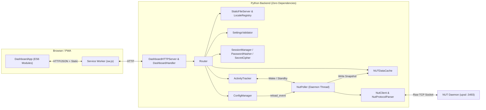
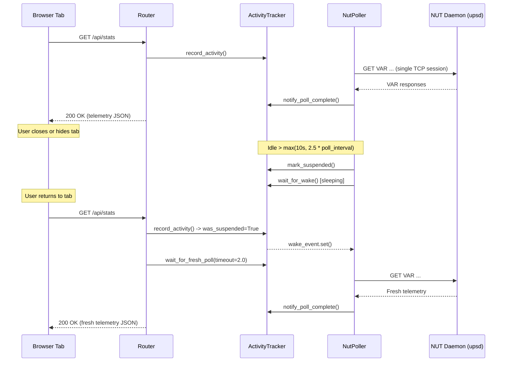

# Architecture Guide — UPS Web Dashboard

This document describes the internal architecture, object-oriented module design, telemetry lifecycle, security model, and REST API of **UPS Web Dashboard**.

---

## 1. Design Principles & Constraints

UPS Web Dashboard is engineered around four strict constraints:

1. **Zero External Python Dependencies**: The backend runs exclusively on the Python standard library (`python:3.12-alpine`), keeping the Docker image compact and memory usage under 15 MB.
2. **Zero Frontend Frameworks or External CDNs**: The frontend consists of modular vanilla ES6 classes, vanilla CSS, and semantic HTML5. No bundler, Node toolchain, or external internet access is required — ensuring reliable operation in isolated or air-gapped LANs.
3. **Demand-Driven Standby**: Background NUT polling pauses automatically whenever no browser clients are active, and browser clients pause polling whenever the tab is hidden (`document.hidden`).
4. **Defense in Depth**: Credentials are never persisted in plaintext, configuration and key files enforce `0600` permissions, all secret comparisons run in constant time, and the container runs as a non-root user (`appuser`, UID `1000`).

---

## 2. High-Level System Overview



---

## 3. Repository Layout

```text
ups-dashboard/
├── docs/
│   └── ARCHITECTURE.md          # Technical architecture guide (this document)
├── data/                        # Runtime persistent storage (mounted into container)
│   ├── .env.example             # Environment configuration template
│   ├── config.json              # Persisted settings & encrypted/hashed credentials (gitignored)
│   └── .secret_key              # 32-byte symmetric master key, chmod 0600 (gitignored)
├── image/                       # Docker build context & application source
│   ├── Dockerfile               # Multi-arch Alpine image (non-root UID 1000)
│   ├── VERSION                  # Single source of truth for application SemVer
│   ├── app.py                   # Entrypoint script & logging bootstrap
│   ├── dashboard/               # Object-oriented Python backend package
│   │   ├── constants.py         # Defaults, path resolution, VERSION loader
│   │   ├── security.py          # KeyManager, PasswordHasher, SecretCipher, SessionManager
│   │   ├── config.py            # ConfigManager (env defaults, JSON persistence, migration)
│   │   ├── nut.py               # NutClient, NutProtocolParser, NutMetrics, NutProtocolError
│   │   ├── collector.py         # NUTDataCache, ActivityTracker, NutPoller
│   │   ├── router.py            # Response, StaticFileServer, LocaleRegistry, SettingsValidator, Router
│   │   └── server.py            # DashboardHTTPServer, DashboardHandler, DashboardApplication
│   └── static/                  # Vanilla frontend & PWA assets
│       ├── index.html           # Semantic HTML5 shell (no inline JS or CSS)
│       ├── manifest.json        # PWA manifest
│       ├── sw.js                # Service Worker with dynamic version cache busting
│       ├── css/
│       │   └── styles.css       # Dark theme, responsive layout, dual gauge/bar styles
│       ├── js/                  # Modular vanilla ES6 classes
│       │   ├── app.js           # DashboardApp (main orchestrator & polling lifecycle)
│       │   ├── api.js           # ApiClient (HTTP client for REST API)
│       │   ├── auth.js          # AuthController (lock screen, login, logout)
│       │   ├── blackout.js      # BlackoutTracker & DurationFormatter (client-side timer)
│       │   ├── dom.js           # DomHelper (selection-safe DOM updates & XSS escaping)
│       │   ├── i18n.js          # I18nManager (locale discovery, fallback, DOM translation)
│       │   ├── pwa.js           # PwaManager (install prompt & Service Worker registration)
│       │   ├── settings.js      # SettingsModalController (4-tab settings dialog)
│       │   ├── telemetry.js     # TelemetryRenderer (bars/gauge rendering & threshold markers)
│       │   └── tooltip.js       # TooltipManager (floating viewport-clamped tooltip)
│       └── locales/             # Auto-discovered JSON localization packs
│           ├── en.json          # English (canonical fallback)
│           ├── it.json          # Italian
│           └── README.md        # Contributor guide for new languages
├── tests/                       # Standard library unittest suite
├── docker-compose.yml           # Docker Compose deployment definition
├── LICENSE                      # MIT License
└── README.md                    # User-facing overview & usage guide
```

---

## 4. Backend Object-Oriented Design

Each Python module under `image/dashboard/` owns a single, well-bounded responsibility:

| Module | Primary Classes | Responsibility |
| :--- | :--- | :--- |
| `constants.py` | *(constants & resolvers)* | Central defaults, container/host `DATA_DIR` resolution, and `VERSION` file loading. |
| `security.py` | `KeyManager`, `PasswordHasher`, `SecretCipher`, `SessionManager` | Master key persistence (`0600`), PBKDF2-HMAC-SHA256 hashing, Encrypt-then-MAC CTR encryption, and thread-safe in-memory session tokens. |
| `config.py` | `ConfigManager` | Merges environment defaults with `data/config.json`, migrates legacy plaintext passwords on startup, enforces `0600` permissions, and triggers `reload_event` on updates. |
| `nut.py` | `NutClient`, `NutProtocolParser`, `NutMetrics`, `NutProtocolError` | Raw TCP socket communication with NUT `upsd`, protocol parsing, numeric extraction, wattage estimation, and fatal error detection. |
| `collector.py` | `NUTDataCache`, `ActivityTracker`, `NutPoller` | Thread-safe telemetry snapshot storage, idle timeout tracking, standby suspension, and on-demand wake-up. |
| `router.py` | `Router`, `Response`, `StaticFileServer`, `LocaleRegistry`, `SettingsValidator` | HTTP routing, REST API controllers, static file MIME/security handling, locale auto-discovery, and settings payload sanitization. |
| `server.py` | `DashboardApplication`, `DashboardHTTPServer`, `DashboardHandler` | Composition root, instance-scoped router binding, HTTP security headers, payload size enforcement (1 MiB cap), and graceful shutdown. |

---

## 5. Telemetry Polling & Standby Lifecycle

To avoid unnecessary network and CPU load when nobody is viewing the dashboard, polling is strictly demand-driven across both client and server:

1. **Client-Side Visibility Pausing**: `DashboardApp` listens for `visibilitychange`. When `document.hidden` becomes `true`, it stops the `fetchStats()` interval and pauses client-side blackout ticks.
2. **Server-Side Standby**: `ActivityTracker` computes an idle threshold of `max(10.0, poll_interval * 2.5)` seconds. If no authenticated client requests `/api/stats` or `/api/settings` within that window, `NutPoller` marks itself suspended and blocks on `ActivityTracker.wait_for_wake()`.
3. **Instant Wake-Up**: As soon as a client reconnects or brings the tab back to the foreground, `Router` calls `tracker.record_activity()`. If the poller was suspended, `Router` briefly awaits `tracker.wait_for_fresh_poll(timeout=2.0)` so the very first response already contains fresh telemetry.



---

## 6. NUT Protocol Integration

`NutClient.fetch_metrics()` opens a single TCP connection to `upsd`, performs optional `USERNAME`/`PASSWORD` authentication, queries all variables sequentially, and sends `LOGOUT` before closing the socket.

| Dashboard Field | Primary NUT Variable | Fallback NUT Variable | Notes |
| :--- | :--- | :--- | :--- |
| `ups_status_raw` | `ups.status` | — | Split on whitespace (`OL`, `OB`, `LB`, `CHRG`, `DISCHRG`, `BYPASS`, etc.). |
| `ups_model` | `device.mfr` + `device.model` | `ups.mfr` + `ups.model` | Concatenated and trimmed. |
| `load` | `ups.load` | — | Rounded integer percentage (`0–100`). |
| `battery` | `battery.charge` | — | Rounded integer percentage (`0–100`). |
| `battery_charge_low` | `battery.charge.low` | — | Optional (`None` if unsupported); drives shutdown threshold marker. |
| `battery_runtime` | `battery.runtime` | — | Optional (`None` if unsupported); seconds of estimated autonomy. |
| `battery_runtime_low` | `battery.runtime.low` | — | Optional (`None` if unsupported); subtracted from runtime while discharging. |
| `watts` | `ups.realpower` | `output.realpower` | Falls back to `round(load * nominal_watts / 100)` when omitted. |
| `nominal_watts` | `ups.realpower.nominal` | `output.realpower.nominal` | Optional maximum rated wattage. |
| `voltage` | `input.voltage` | `output.voltage` | Rounded to 1 decimal place. |

Unsupported individual variables (`ERR VAR-NOT-SUPPORTED`) degrade gracefully to `None`. Fatal daemon errors (`UNKNOWN-UPS`, `DATA-STALE`, `DRIVER-NOT-CONNECTED`, and authentication errors) raise `NutProtocolError` immediately and mark the cache offline with the diagnostic message.

---

## 7. Frontend Object-Oriented Architecture

The browser client is organized into 10 focused ES6 classes under `image/static/js/` loaded via `<script type="module" src="/js/app.js?v=__APP_VERSION__">`:

- **`DashboardApp` (`app.js`)**: Composition root managing startup, polling schedule, and `visibilitychange` suspension/resumption.
- **`ApiClient` (`api.js`)**: Encapsulates all `fetch()` calls and standardized `401 Unauthorized` detection.
- **`TelemetryRenderer` (`telemetry.js`)**: Synchronizes both Horizontal Bar and Semicircle SVG Gauge views, color severity tiers, shutdown threshold markers, and discharge-only runtime calculations.
- **`SettingsModalController` (`settings.js`)**: Manages the 4-tab Settings modal (`Status`, `NUT Server`, `Appearance`, `Security`), form validation, preset buttons, and toast notifications.
- **`AuthController` (`auth.js`)**: Controls the password lock screen, `/api/login` submission, and `/api/logout` session locking.
- **`BlackoutTracker` & `DurationFormatter` (`blackout.js`)**: Maintains the client-side blackout timer with `sessionStorage` continuity across reloads and pauses automatically when hidden.
- **`TooltipManager` (`tooltip.js`)**: Controls the shared fixed `#ui-tooltip` overlay with viewport clamping and unified mouse hover, touch tap, and keyboard focus support.
- **`I18nManager` (`i18n.js`)**: Discovers locale packs via `/api/locales`, loads JSON bundles with version cache-busting, applies declarative `data-i18n*` attributes, and falls back to English per key.
- **`DomHelper` (`dom.js`)**: Selection-safe DOM setters (`setText`, `setClass`, `setStyle`) that skip unchanged values or nodes intersecting active user text selection, plus `escapeHtml()` for XSS protection.
- **`PwaManager` (`pwa.js`)**: Captures `beforeinstallprompt` for native PWA installation and registers `/sw.js`.

### Versioning & PWA Cache Invalidation

`image/VERSION` is the **single source of truth** for the application version:

- `StaticFileServer` replaces `__APP_VERSION__` dynamically when serving `/` (`index.html`) and `/sw.js`.
- Updating `image/VERSION` automatically bumps the Service Worker `CACHE_NAME` (`ups-dashboard-v<VERSION>`) and asset query strings (`/css/styles.css?v=<VERSION>`, `/js/app.js?v=<VERSION>`, `/locales/<code>.json?v=<VERSION>`), causing installed PWAs to purge old caches cleanly.

---

## 8. Security Model

- **Dashboard Password Hashing**: Irreversible `PBKDF2-HMAC-SHA256` with 100,000 iterations and a unique 16-byte random salt per password (`PasswordHasher`). Verified via `secrets.compare_digest`.
- **At-Rest NUT Credential Encryption**: Reversible authenticated stream cipher built from standard-library `HMAC-SHA256` in counter mode plus Encrypt-then-MAC integrity tag (`SecretCipher`). Uses a random 32-byte key stored in `data/.secret_key`.
- **Filesystem Permissions**: Both `data/.secret_key` and `data/config.json` are written with `0600` (owner read/write only).
- **Session Management**: 48-hex-character random session tokens stored in memory (`SessionManager`) and delivered via `HttpOnly; SameSite=Lax` cookies (or `Authorization: Bearer <token>`).
- **Input & HTTP Hardening**:
  - `SettingsValidator` and `NutClient` strip `\r` and `\n` to prevent NUT TCP command injection.
  - `StaticFileServer` uses `os.path.commonpath` to block directory traversal outside `image/static/`.
  - `DashboardHandler` rejects POST bodies larger than 1 MiB (`413 Payload Too Large`) and injects `X-Content-Type-Options: nosniff`, `X-Frame-Options: DENY`, and `Referrer-Policy: no-referrer` on every response.
- **Container Isolation**: `image/Dockerfile` executes as unprivileged user `appuser` (UID `1000`).

---

## 9. REST API Specification

| Method | Path | Auth Required | Description |
| :--- | :--- | :---: | :--- |
| `GET` | `/api/health` | No | Lightweight health check returning `{"status": "ok", "version": "..."}` (used by Docker `HEALTHCHECK`). |
| `GET` | `/api/version` | No | Returns the canonical application version string. |
| `GET` | `/api/locales` | No | Lists auto-discovered localization packs and default locale (`"en"`). |
| `GET` | `/api/stats` | If configured | Returns live UPS telemetry, target NUT metadata, polling interval, and auth status. Wakes standby poller. |
| `GET` | `/api/settings` | If configured | Returns non-sensitive configuration flags (`has_nut_password`, `has_dashboard_password`) and live diagnostics. |
| `POST` | `/api/settings` | If configured | Validates and persists updated NUT connection parameters, polling interval, or passwords. |
| `POST` | `/api/login` | No | Validates `{"password": "..."}` and sets the `ups_dashboard_session` `HttpOnly` cookie. |
| `POST` | `/api/logout` | No | Revokes the active session token and clears the session cookie. |

---

## 10. Testing & Release Workflow

Run the standard library test suite:

```bash
python3 -m unittest discover -s tests -v
```

Validate locale JSON files:

```bash
python3 -c 'import json; [json.load(open(p, encoding="utf-8")) for p in ("image/static/locales/en.json", "image/static/locales/it.json")]'
```

To cut a new release, bump the SemVer string in `image/VERSION` and rebuild the Docker image (`docker compose up -d --build`).
